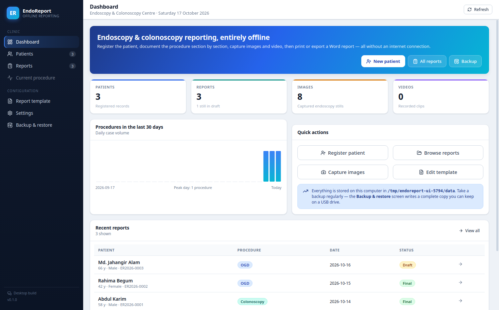
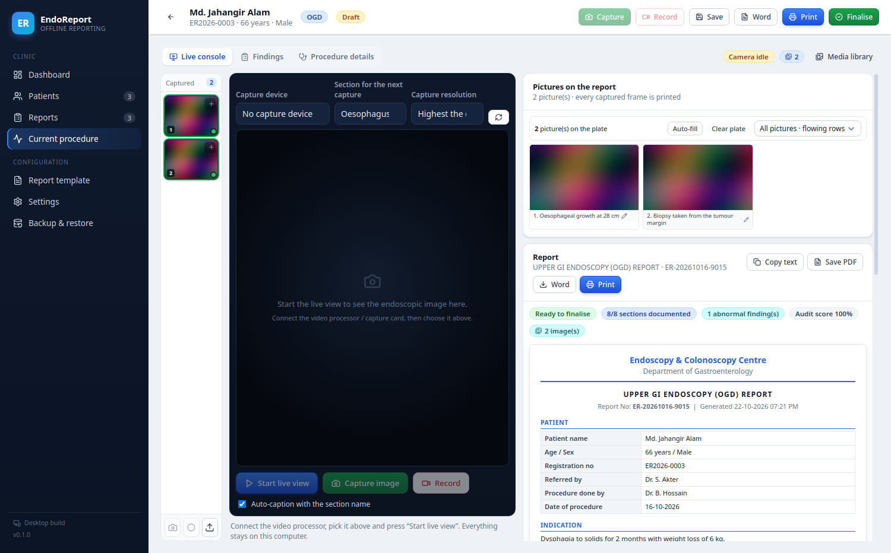
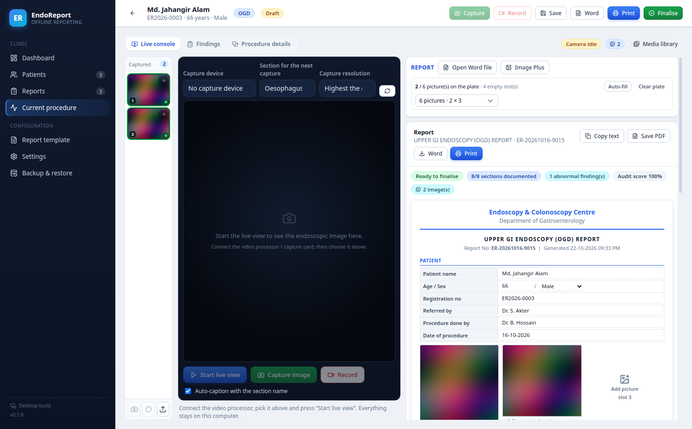
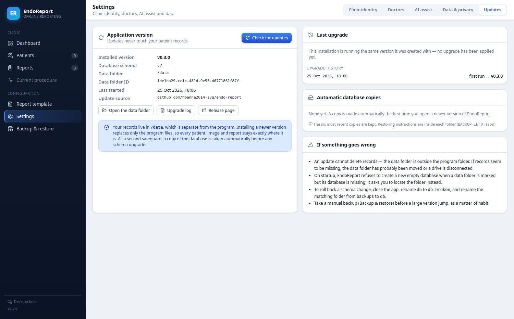
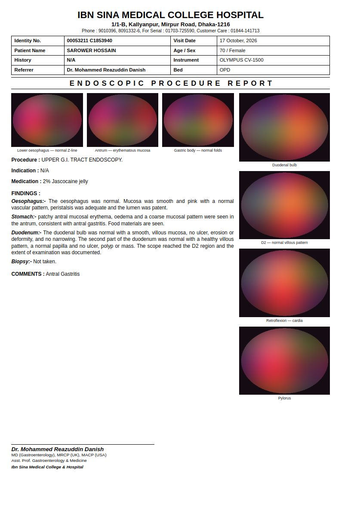

# EndoReport

Offline desktop software for **upper GI endoscopy (OGD)** and **colonoscopy** reporting.
Built for a clinic that has no reliable internet: everything — the database, the image
capture, the report engine and the Microsoft Word export — runs on the local computer.

Electron + React + a local PostgreSQL (PGlite/WASM) database. No server to install, no
cloud account, no telemetry.

| | |
|---|---|
|  |  |
|  |  |

---

**Download the ready-to-run build:** [github.com/hbanna2014-svg/endo-report/releases](https://github.com/hbanna2014-svg/endo-report/releases) — no Node.js, no installation, works offline.

## 1. What it does

| Requirement | How it is implemented |
|---|---|
| Fully offline, computer-based | Everything is local. Only the *optional* AI image review needs the internet, and it is off by default |
| Automatic report generation | Tick findings → the narrative, **Impression** and **Recommendation** blocks are written for you |
| Automatic section placement | Each procedure has its own ordered anatomical sections; findings are inserted into the correct section automatically |
| Image capture with captions | Live view from a video processor / USB capture card, one-click still capture, editable captions, per-section tagging |
| Video recording | One-click recording of the live stream, saved with the patient record |
| Auto problem detection | A 25-rule completeness and safety audit scores every report and blocks finalisation while a blocking issue remains |
| Microsoft Word report | Real `.docx` generated locally, with the letterhead, tables, impression, recommendations and embedded images |
| Print | Native print dialog, plus "Save as PDF" |
| Patient entry | Name, age, sex, test name, referring doctor, performing doctor, indication, history, allergy, medication, notes |
| Patient database | Searchable register; every patient keeps their full report history |
| Edit & reprint | Any report can be reopened, edited, reprinted and re-exported |
| Colourful, user-friendly UI | Colour-coded procedure types, severity chips, live completeness score, plain-language messages |
| Capture and write in one view | The **Live console** puts the captured frames, the live endoscopic image and the report side by side — no tab switching mid-procedure |
| Your own Word template | Import the clinic's `.docx`, edit its lines in the app, and every exported report is written **into that file** so the letterhead, fonts and page setup survive |
| 4- or 6-picture sheet | The report is laid out like the clinic's own form: **four pictures down the right-hand side**, or **six as three across the top and three down the right** — filled automatically by each capture and editable in place |
| Open your Word report | *Open Word file* reads the clinic's `.docx` straight onto the report page — paragraphs, bold/italic/underline, alignment, font and size, tables and pictures included — and it is edited there |
| Full formatting toolbar | Bold, italic, underline, strike-through, bullets, numbers, four alignments, indent, font family, font size, text colour, undo/redo and clear formatting |
| Image Plus page | One page with four or six large frames: click a frame to add a picture, *Fill automatically*, *Capture now*, or clear the set |
| Report edited on the page | The findings block and the patient fields are written straight onto the sheet, with a bold / italic / underline / list / alignment toolbar — the same way the old program worked |
| Sharp pictures | Frames are stored at the capture device's own resolution as lossless PNG and embedded at that size in print and Word — never re-compressed |

**Catalogue size:** 8 OGD sections + 11 colonoscopy sections = **19 anatomical sections**, with **121
structured findings** and their value fields.

---

## 2. Report layouts

Two print layouts ship with the software. Pick one per template in **Report template**.

### Hospital paper form

Reproduces the printed form the unit already uses:

- letterhead with logo, hospital name, address and telephone lines;
- a four-column grid — **Identity No. · Visit Date · Patient Name · Age / Sex · History ·
  Instrument · Referrer · Bed**;
- the letter-spaced `ENDOSCOPIC PROCEDURE REPORT` band;
- **three pictures across the top and four down the right-hand column** (seven-picture plate);
- findings grouped by organ with `Oesophagus:-` style headings, plus `Biopsy:- Not taken.`;
- a `COMMENTS :` block, and the endoscopist's signature with degrees, designation and hospital.

The on-screen preview, the printed page and the exported `.docx` are all produced from one model,
so they match. An optional trailing sheet prints six pictures on a 2 × 3 grid with the
"Image Plus 1–6" row.



The identity and file numbers come from the patient record (**Patients ▸ Hospital identity no. /
Visit no.**) and can be overridden on the report itself, along with **Instrument**, **Bed**,
**Medication** and **Comments** on the *Procedure details* tab.

### Narrative report

Letterhead, patient table, narrative findings, impression, recommendations and a picture plate —
useful for referral letters and for clinics without a fixed paper form.

---

## 3. Requirements

- **Windows 10 / 11 (64-bit)** for the installer build
- **Node.js 20 or newer** — only needed to *build* the installer, not to run it
- For image/video capture: a video processor or capture card that Windows recognises as a
  camera (most endoscopy units expose a USB/HDMI capture device)

---

## 4. Running it

### Development (hot reload)

```bash
npm install
npm run dev
```

### Run the built application

```bash
npm start
```

### Build the Windows installer

On a Windows machine, double-click **`build-windows.bat`**, or run:

```bash
npm install
npm test          # offline self-test of the reporting engine
npm run dist      # produces release/EndoReport-Setup-0.4.0.exe
```

The installer is created in `release/`. It is an assisted (non-silent) NSIS installer, so the
clinic can choose the install folder and gets desktop and Start-menu shortcuts.

### Verify the build

```bash
npm test                                            # reporting engine + Word export
xvfb-run -a npx electron scripts/e2e.cjs --no-sandbox   # full database end-to-end (Linux/CI)
npx electron scripts/e2e.cjs                        # full database end-to-end (Windows)
```

`scripts/seed-demo.cjs` fills a data folder with three demonstration patients so the software
can be shown to a clinic without typing anything.

---

## 5. Where the data lives

```
<Documents>\EndoReportData\
├── db\        the PostgreSQL database (PGlite)
├── media\     images and videos, one folder per patient
└── exports\   Word / PDF files you save here
```

Set the environment variable `ENDOREPORT_DATA_DIR` to keep the whole dataset somewhere else
(for example a USB drive) — useful for a portable installation.

**Backup:** *Backup & restore ▸ Backup now* writes a folder containing `data.json` plus a full
copy of `media`. Restoring replaces everything and asks for confirmation first. Merge-import
from a JSON file is available when you do not want to erase what is already on the machine.

---

## 6. Using the software — the short version

### The live console (the screen you work on)

```
 captured frames  |  live endoscopic image  |  picture plate + report
        rail      |     + capture buttons   |     (edit and print here)
```

1. Pick the capture device, the anatomical section and the resolution, then **Start live view**.
2. **Capture** (top bar, the button under the image, the camera button on the rail, or `F9`) saves the
   current frame at the sensor's full resolution. The frame appears in the rail immediately and, on a
   4- or 6-picture plate, drops into the next free slot by itself.
3. The report itself carries the pictures, exactly as they will print:
   * **Four pictures** — one column down the right-hand side, each with its caption underneath.
   * **Six pictures** — three across the top, then three down the right-hand side.
   Click an empty slot to add a picture, use the tools on a filled one to replace / move / re-caption /
   remove it, or switch between the two arrangements in the plate bar. *Auto-fill* takes the first
   four or six frames; *Clear plate* empties it without deleting anything.
4. Write the findings **on the sheet**. The text is generated from the ticked findings and can then be
   typed over, bolded, bulleted or re-aligned; *Regenerate* puts the generated wording back. The patient
   fields at the top are editable in the same way.
5. **Print**, **Word** or **Save PDF** — screen, printer and `.docx` all come from one model.

The *Findings* and *Procedure details* views keep the camera streaming (it parks off-screen), so the
Capture button in the top bar still works while you are typing a finding.

### Using your own Word report file

1. **Report template → Use your own Word file → Import** and choose the `.docx`.
2. The file's own paragraphs are listed and can be edited in place. Put a placeholder such as
   `{{PATIENT_NAME}}` or `{{FINDINGS}}` where a value belongs; the `＋` box on each line inserts one.
3. `{{FINDINGS}}`, `{{IMPRESSION}}`, `{{RECOMMENDATION}}`, `{{DETAILS}}`, `{{IMAGES}}` and
   `{{SIGNATURE}}` each need **their own line** — the block expands from there.
4. **Save**, then every **Word** export of every report is written into that file. If a particular file
   cannot be merged, a standard report is written instead and the export says so — a report is never lost.

1. **Settings ▸ Clinic identity** — enter the clinic name, address, phone, logo and the default
   endoscopist signature. These appear on every report.
2. **Settings ▸ Doctors** — add your endoscopists and referring physicians.
3. **Patients ▸ New patient** — register the patient (name, age, sex, referring doctor,
   indication, history). The registration number is generated automatically.
4. **New report** — choose *Upper GI Endoscopy*, *Colonoscopy* or *Both*, and the date.
5. In the workspace:
   - **Findings** tab — walk the sections down the left; tick a finding and fill in its values
     (LA grade, polyp size, Forrest class, BBPS…).
   - **Procedure details** tab — extent reached, times, sedation, biopsy, complications,
     H. pylori, bowel preparation.
   - **Images** tab — start the live view, capture stills, record video, edit captions.
   - **Report** tab — read the finished report exactly as it will print.
6. Watch the **Documentation audit** panel on the right. Red items block finalisation; amber
   items are worth a look; blue items are optional improvements.
7. **Print**, **Word**, or **Save PDF**. Press **Finalise** to mark the report as signed.

### Keyboard shortcuts

| Key | Action |
|---|---|
| `Ctrl+N` | New patient |
| `Ctrl+P` | Patient list |
| `Ctrl+S` | Save the report |
| `Ctrl+Shift+P` | Print |
| `Ctrl+E` | Export to Microsoft Word |
| `F9` | Capture an image |
| `F10` | Start / stop video recording |

---

## 7. What the audit checks

The audit is decision *support*; it never changes the medical content of your report.

**Blocking (must be resolved before finalising)**
- A finding that requires histological confirmation was recorded but no biopsy is documented
- A suspected malignancy without a biopsy
- The terminal ileum recorded as normal while the recorded extent does not include it
- Active or spontaneous bleeding documented without a note on haemostasis
- A required value missing on a malignancy finding (for example the size of a polyp)
- Contradictory entries (terminal ileum both normal and not intubated)

**Warnings**
- Required values missing (LA grade for reflux oesophagitis, size of a polyp, Forrest class…)
- "Normal" and an abnormal finding ticked in the same section
- "Not examined" ticked together with another finding in the same section
- Colonoscopy: extent not documented; incomplete BBPS; inadequate preparation (total < 6 or any
  segment < 2); withdrawal time under 6 minutes; caecal findings with a recorded extent that
  stops short of the caecum; terminal ileum reached but not documented
- A finding that normally requires biopsy (Barrett, colitis) with no biopsy recorded
- Biopsy recorded without documenting the sites
- Polyps recorded without a size

**Suggestions**
- An expected section left completely undocumented
- D2 not documented in an OGD
- Inflammatory gastric findings without H. pylori status
- Oesophageal candidiasis without a note on diabetes / immunosuppression screening
- Varices without portal hypertension workup
- Complications field left blank (an empty field is not the same as "no complication")
- Sedation not recorded; no images captured; reason for a partial examination not recorded

Every report gets a completeness score (coverage of expected sections, minus penalties).

---

## 8. Extending it

- **Add or change a finding** — `src/lib/findings-ogd.js` and `src/lib/findings-colon.js`.
  A finding is a small object with `phrase` (narrative), `impression`, `advice`, `fields` and
  `severity`. `{field_key}` placeholders are replaced with what the endoscopist enters, and the
  self-test fails if a placeholder does not match a real field.
- **Add or reorder a section** — `src/lib/anatomy.js`.
- **Change the audit rules** — `detectProblems()` in `src/lib/autoReport.js`.
- **Change the layout** — either from *Report template* inside the app, or in
  `DEFAULT_TEMPLATE` inside `src/lib/reportModel.js` for the built-in default.
- **Change the Word layout** — `electron/docx.cjs`.

The engine is covered by `npm test`, so any change that breaks a template placeholder or leaves
a section without a finding catalogue is caught before shipping.

---

## 9. Updating safely

The patient database lives in its own folder, **outside** the program folder, so replacing the
application can never delete a record. On top of that:

| Situation | What happens |
|---|---|
| You install a newer version | Program files are replaced; `EndoReportData` is untouched |
| The new version changes the database layout | A copy of `db/` is written to `EndoReportData/backups/` **before** the migration, then the migration runs inside a transaction |
| A migration fails | It rolls back, the records are unchanged, and startup shows the reason plus where the copy is |
| The data folder is missing (drive unplugged, folder moved) | Startup stops and asks you to locate it instead of creating a new, empty database |
| The data folder was written by a newer build | Startup refuses and tells you to update the app first |
| A download is corrupted | Size is checked, and SHA-256 when the release publishes `checksums.txt`; the Run button is disabled on a mismatch |

**Checking for updates.** *Settings ▸ Updates ▸ Check for updates* compares the installed version
with the latest GitHub release, shows the release notes, downloads and verifies the artefact, and
can start the installer. *Help ▸ Check for updates…* does the same.

**Publishing a new version** (maintainer):

```bash
# bump "version" in package.json and update CHANGELOG.md, then:
npm test
npm run dist          # -> release/EndoReport-Setup-x.y.z.exe + portable .zip
npm run checksums     # -> release/checksums.txt
```

Upload the `.exe`, the `.zip` and `checksums.txt` to a GitHub release tagged `vX.Y.Z`, or let
electron-builder do it:

```bash
set GH_TOKEN=ghp_...      # Windows
npm run release:win
```

Extract the portable ZIP **over** the old program folder (or into a fresh folder) — the data folder
is not inside it, so nothing is lost either way. Every upgrade is written to
`EndoReportData/upgrade.log` and listed on the Updates screen.

---

## 10. Clinical and legal caveats

- The recommendations (including the post-polypectomy surveillance interval) follow widely used
  BSG/ESGE-style conventions. They are **decision support only** — the endoscopist and the
  histopathology report always take precedence.
- The optional AI image review is explicitly instructed not to diagnose. Its output is shown in
  a review dialog and is never written into a report automatically.
- Keep **one master installation per clinic**. Two databases cannot be reconciled automatically.
- Take a backup at the end of every working day and test a restore once on a spare computer.

---

# বাংলা — সংক্ষিপ্ত ব্যবহার নির্দেশিকা

**এন্ডোরিপোর্ট** একটি সম্পূর্ণ অফলাইন ডেস্কটপ সফটওয়্যার — এন্ডোস্কোপি ও কোলোনোস্কোপির রিপোর্ট তৈরি,
ছবি-ভিডিও ক্যাপচার, ডেটাবেজ এবং MS Word এক্সপোর্ট সব কিছু কম্পিউটারেই চলে। ইন্টারনেট লাগে না।

### চালু করার নিয়ম

1. Windows কম্পিউটারে **Node.js 20+** ইনস্টল করে `build-windows.bat` ফাইলে ডাবল-ক্লিক করুন।
2. কিছুক্ষণ পর `release` ফোল্ডারে **EndoReport-Setup-0.4.0.exe** তৈরি হবে — এটিই ক্লিনিকের
   কম্পিউটারে ইনস্টল করবেন।
3. সংস্করণ পরীক্ষা করতে ইনস্টলেশনের আগে একবার ডেমো ডেটা দিয়ে দেখে নিতে পারেন:
   `scripts/seed-demo.cjs` তিনজন ডেমো রোগী তৈরি করে।

### প্রথম দিনের সেটআপ

1. **Settings ▸ Clinic identity** — ক্লিনিকের নাম, ঠিকানা, ফোন, লোগো ও ডাক্তারের নাম লিখে
   **Save** চাপুন। এগুলো প্রতিটি রিপোর্টে ছাপা হবে।
2. **Settings ▸ Doctors** — যে ডাক্তাররা প্রসিডিউর করবেন ও রেফার করবেন তাঁদের যোগ করুন।
3. **Patients ▸ New patient** — রোগীর নাম, বয়স, সেক্স, টেস্টের কারণ, রেফারিং ডাক্তার,
   ইতিহাস লিখুন। রেজিস্ট্রেশন নম্বর নিজে থেকেই তৈরি হবে।

### রিপোর্ট লেখার নিয়ম

1. রোগী সিলেক্ট করে **New report** — প্রসিডিউর বাছুন (OGD / Colonoscopy / Both)।
2. **Findings** ট্যাবে বাঁ দিকের সেকশন ধরে ধরে যা যা দেখছেন টিক দিন। পলিপের সাইজ, LA grade,
   Forrest class — যা জিজ্ঞেস করবে সেগুলো পূরণ করুন। ডান দিকে **Impression** নিজে থেকেই তৈরি হবে।
3. **Procedure details** — কতদূর পর্যন্ত দেখা হয়েছে, কত সময়, বায়োপসি, কমপ্লিকেশন,
   বাওয়েল প্রিপারেশন স্কোর (BBPS) ইত্যাদি।
4. **Images** — ক্যাপচার কার্ড/ক্যামেরা সিলেক্ট করে **Start live view**, তারপর **Capture image**
   বা **Record video**। ক্যাপশন লেখা যাবে।
5. **Report** ট্যাবে পুরো রিপোর্ট দেখে **Print** / **Word** / **Save PDF** করুন।
6. ডান দিকের **Documentation audit** — লাল লেখা মানে রিপোর্ট Final করা যাবে না, কিছু বাকি আছে।
   উপরের **Score** যত বেশি, রিপোর্ট তত সম্পূর্ণ। সমস্যা থাকলে **Go to the section** চেপে
   সরাসরি সেই সেকশনে যাওয়া যাবে।
7. **Finalise** চাপলে রিপোর্ট চূড়ান্ত (Final) হিসেবে চিহ্নিত হবে। পরে আবার খুলে এডিটও করা যাবে।

### ডেটা ও ব্যাকআপ

- সব ডেটা থাকে `Documents\EndoReportData\` ফোল্ডারে — `db`, `media`, `exports`।
- প্রতিদিন কাজ শেষে **Backup & restore ▸ Backup now** চেপে একটি পেনড্রাইভে কপি রাখুন।
- **Restore** পুরোনো সব ডেটা মুছে ব্যাকআপ বসিয়ে দেয় — তাই আগে কনফার্মেশন চাইবে।
- ক্লিনিকে একটি মাত্র কম্পিউটারে ডেটা রাখুন (মাস্টার)। দুইটি আলাদা ডেটাবেজ পরে মেলানো যায় না।

### গুরুত্বপূর্ণ

- অটো **Recommendation** (যেমন পলিপের পর কত বছরে আবার কোলোনোস্কোপি) শুধু সহায়িকা —
  চূড়ান্ত সিদ্ধান্ত ডাক্তার ও হিস্টোপ্যাথলজি রিপোর্টের।
- **AI review** অপশনটি ডিফল্টভাবে বন্ধ এবং এটিই একমাত্র ফিচার যার ইন্টারনেট দরকার। চালু করলে
  ক্যাপচার করা ছবি আপনার দেওয়া সার্ভারে যায় — তাই ক্লিনিকের নিয়ম অনুযায়ী সিদ্ধান্ত নিন।
  AI কখনোই নিজে থেকে রিপোর্টে কিছু লেখে না; প্রতিটি প্রস্তাব ডাক্তারকে দেখে অনুমোদন করতে হয়।

### আপডেট করলে ডেটা নিরাপদ থাকে

- প্রোগ্রাম ফোল্ডার আর ডেটা ফোল্ডার সম্পূর্ণ আলাদা। নতুন ভার্সন ইনস্টল করলে শুধু প্রোগ্রামের ফাইল
  বদলায় — `Documents\EndoReportData\` অপরিবর্তিত থাকে, রোগীর কোনো তথ্য মুছে যায় না।
- নতুন ভার্সনে ডেটাবেজের গঠন বদলালে **আগেই** `EndoReportData\backups\` ফোল্ডারে ডেটাবেজের একটি
  কপি রাখা হয়, তারপর আপগ্রেড হয়। কোনো ধাপ ব্যর্থ হলে সেটি বাতিল হয়ে যায়, তথ্য নষ্ট হয় না।
- ডেটা ফোল্ডার না পাওয়া গেলে (পেনড্রাইভ খোলা, ফোল্ডার সরানো বা ডিলিট) সফটওয়্যার নিজে থেকে নতুন
  খালি ডেটাবেজ বানায় না — বরং ফোল্ডারটি কোথায় আছে জিজ্ঞেস করে।
- **Settings ▸ Updates** থেকে নতুন ভার্সন চেক ও ডাউনলোড করা যায়। ডাউনলোড করা ফাইলের সাইজ এবং
  থাকলে SHA-256 যাচাই হয়; মিল না হলে ইনস্টল বোতাম নিষ্ক্রিয় হয়ে যায়।
- প্রতিটি আপগ্রেডের রেকর্ড থাকে `EndoReportData\upgrade.log` ফাইলে, আর শেষ ছয়টি ডেটাবেজ কপি
  `backups` ফোল্ডারে জমা থাকে।
